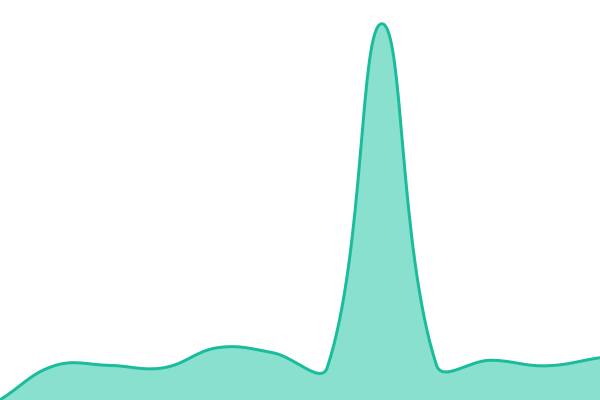

# [📈 Live Status](https://status.alphai.io): <!--live status--> **🟧 Partial outage**

This repository contains the open-source uptime monitor and status page for [Mikhail Makeev](https://alphai.io/), powered by [Upptime](https://github.com/upptime/upptime).

With [Upptime](https://upptime.js.org), you can get your own unlimited and free uptime monitor and status page, powered entirely by a GitHub repository. We use [Issues](https://github.com/makeev/alphai-status/issues) as incident reports, [Actions](https://github.com/makeev/alphai-status/actions) as uptime monitors, and [Pages](https://status.alphai.io) for the status page.

<!--start: status pages-->
<!-- This summary is generated by Upptime (https://github.com/upptime/upptime) -->
<!-- Do not edit this manually, your changes will be overwritten -->
<!-- prettier-ignore -->
| URL | Status | History | Response Time | Uptime |
| --- | ------ | ------- | ------------- | ------ |
|  [Website](https://alphai.io/api/health_check) | 🟩 Up | [website.yml](https://github.com/makeev/alphai-status/commits/HEAD/history/website.yml) | 

 620ms
     
 | 

<a href="https://status.alphai.io/history/website">99.85%</a>
    

|  [REST API](https://api.alphai.io/api/health/ready) | 🟥 Down | [rest-api.yml](https://github.com/makeev/alphai-status/commits/HEAD/history/rest-api.yml) | 

 474ms
     
 | 

<a href="https://status.alphai.io/history/rest-api">99.57%</a>
    

|  [Public API gate](https://api.alphai.io/api/news/) | 🟩 Up | [public-api-gate.yml](https://github.com/makeev/alphai-status/commits/HEAD/history/public-api-gate.yml) | 

 1797ms
     
 | 

<a href="https://status.alphai.io/history/public-api-gate">99.95%</a>
    

|  [MCP server](https://mcp.alphai.io/health) | 🟥 Down | [mcp-server.yml](https://github.com/makeev/alphai-status/commits/HEAD/history/mcp-server.yml) | 

 916ms
     
 | 

<a href="https://status.alphai.io/history/mcp-server">99.59%</a>
    

<!--end: status pages-->

[**Visit our status website →**](https://status.alphai.io)

## 📄 License

- Powered by: [Upptime](https://github.com/upptime/upptime)
- Code: [MIT](./LICENSE) © [Anand Chowdhary](https://anandchowdhary.com)
- Data in the `./history` directory: [Open Database License](https://opendatacommons.org/licenses/odbl/1-0/)
